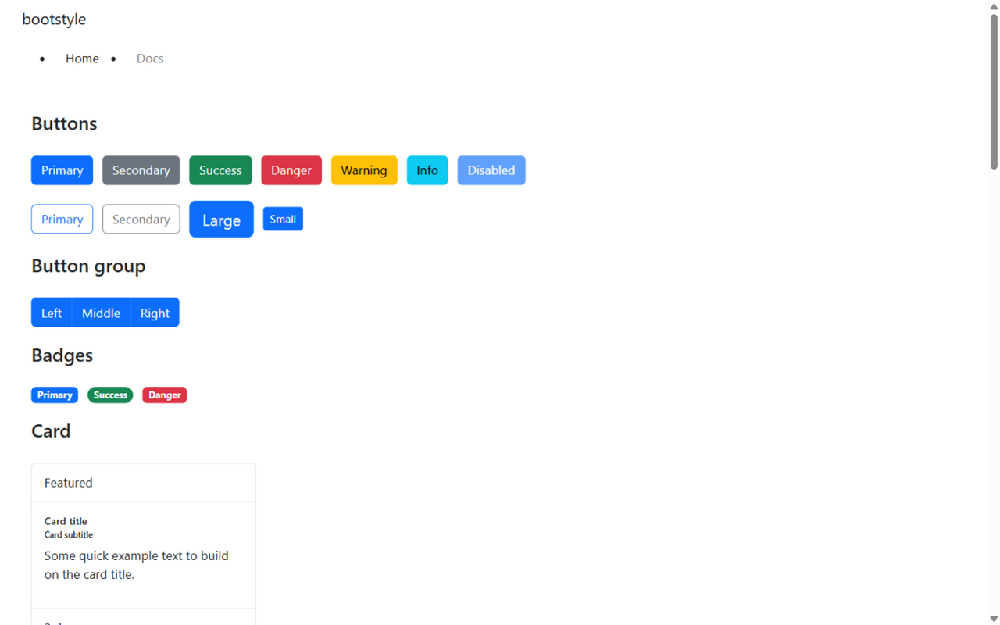

# bootstyle

Bootstrap 5 UI components for Rust: typed builders that render styled, framework-agnostic HTML.

No JS runtime, no framework lock-in. Works with axum, actix-web, rocket, static site generators, or plain string output. Forms, tables and navigation are real HTML elements and stay interactive without JavaScript.

**Siblings in the family** — same builder API, different design systems: [matui](https://crates.io/crates/matui) (Material Design 3) and [taigaui](https://crates.io/crates/taigaui) (Taiga UI).



*(Full-page gallery: [gallery-full.png](https://raw.githubusercontent.com/StarcevAlexander/bootstyle/main/docs/screenshots/gallery-full.png))*

## Interactive demo

Run the bundled gallery example and open the generated file in a browser — forms, tables and navigation are live:

```bash
cargo run --example basic > gallery.html
```

The `main` branch of the repository also serves this gallery via GitHub Pages: https://starcevalexander.github.io/bootstyle/

## Usage

```rust
use bootstyle::{Button, Card, Render, css};

fn main() {
    let card = Card::new()
        .title("Bootstrap for Rust")
        .body("Framework-agnostic HTML builders.")
        .footer("2 days ago");

    let page = format!(
        "<html><head><style>{}</style></head><body>{}{}</body></html>",
        css::stylesheet(),
        Button::new("Get started").render(),
        card.render(),
    );
    println!("{page}");
}
```

## Components

| Category | Components |
|---|---|
| Actions | `Button` (8 colors x filled/outline, lg/sm), `ButtonGroup` (horizontal/vertical) |
| Typography | `Badge` (8 colors, pill) |
| Layout | `Container`, `Row` (col spans 1-12), `Card` |
| Forms | `Input` (incl. floating label), `Select`, `Checkbox`, `Radio`, `Switch`, `Range` |
| Data | `Table` (striped/hover/bordered/dark), `ListGroup` (active/disabled/flush) |
| Navigation | `Navbar` (light/dark), `NavTabs` (tabs/pills), `Breadcrumb`, `Pagination` |
| Feedback | `Alert` (dismissible), `Toast`, `Spinner` (border/grow), `Progress` (striped/animated), `Placeholder` |
| Overlays | `Modal`, `Offcanvas`, `Dropdown`, `Tooltip` |
| Dynamic | `Accordion`, `Carousel` |

Every component implements `Render`, returning an HTML string. All classes are native Bootstrap 5 classes, so the bundled stylesheet never fights your own CSS. Design tokens are exposed as CSS custom properties (`--bs-primary`, `--bs-border-radius`, ...).

## License

Licensed under either of MIT or Apache-2.0, at your option.

Not affiliated with the Bootstrap team. Bootstrap is released under the MIT license by its authors; this crate only provides Rust builders that emit Bootstrap-compatible markup and CSS.
